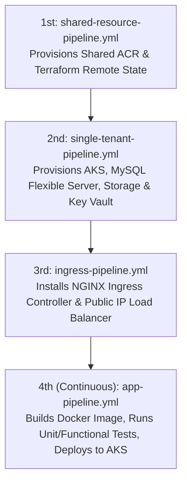

# 🏫 School Management System (HDPS) — Infrastructure & CI/CD Architecture Guide

A production-ready, enterprise-grade School Management System built on **Laravel 8 (PHP 8.0 FPM)**, containerized with **Docker & Nginx**, provisioned with **Terraform (IaC)**, and continuously built, tested, and deployed to **Azure Kubernetes Service (AKS)** with **Azure Container Registry (ACR)** and **Azure Key Vault**.

- **Live Application URL:** [http://school.hdps.online](http://school.hdps.online)
- **Primary Domain (Hostinger DNS):** `hdps.online` $\rightarrow$ Subdomain `school.hdps.online`
- **Public Ingress IP:** `52.226.103.116`
- **Azure Region:** Central India / East US (`school-dev-rg`)

---

## 📑 Table of Contents
1. [Architecture Overview](#1-architecture-overview)
2. [End-to-End Pipeline Execution Hierarchy (Which Runs 1st, 2nd, etc.)](#2-end-to-end-pipeline-execution-hierarchy)
   - [Pipeline 1: Shared Resources (`shared-resource-pipeline.yml`)](#pipeline-1-shared-resources-infrastructure-run-1st)
   - [Pipeline 2: Single Tenant Infrastructure (`single-tenant-pipeline.yml`)](#pipeline-2-single-tenant-infrastructure-run-2nd)
   - [Pipeline 3: Ingress Controller & Routing (`ingress-pipeline.yml`)](#pipeline-3-ingress-controller--routing-run-3rd)
   - [Pipeline 4: Application CI/CD (`app-pipeline.yml`)](#pipeline-4-application-cicd-pipeline-runs-continuously-on-code-changes)
3. [Security & Secrets Management (Zero-Hardcoding Architecture)](#3-security--secrets-management-zero-hardcoding)
4. [Database Management & SSL Architecture](#4-database-management--ssl-architecture)
5. [Azure Key Vault Integration Workflow](#5-azure-key-vault-integration-workflow)
6. [Ingress Controller & Custom Subdomain Routing](#6-ingress-controller--custom-subdomain-routing)
7. [Automated Testing Suite (Unit & Functional)](#7-automated-testing-suite)
8. [Comprehensive File-by-File Reference Directory](#8-comprehensive-file-by-file-reference-directory)
9. [Default Application Roles & Credentials](#9-default-application-roles--credentials)

---

## 1. Architecture Overview

```
                      +---------------------------------------+
                      |           Hostinger DNS               |
                      |   A Record: school -> 52.226.103.116  |
                      +---------------------------------------+
                                          |
                                          v
                      +---------------------------------------+
                      |    NGINX Ingress Controller (AKS)     |
                      |   Public IP: 52.226.103.116 (Port 80) |
                      +---------------------------------------+
                                          |
                        Routing Rule: host == school.hdps.online
                                          |
                                          v
                      +---------------------------------------+
                      |       Kubernetes ClusterIP Service    |
                      |          school-sms-service:80        |
                      +---------------------------------------+
                                          |
                                          v
                      +---------------------------------------+
                      |         Kubernetes Deployment         |
                      |        Pod: school-sms (dev ns)       |
                      |  [Nginx :80] -> [PHP 8.0-FPM :9000]   |
                      +---------------------------------------+
                                     /         \
                 Pulls image from   /           \  Queries via TLS/SSL
                                   v             v
        +-----------------------------+     +-------------------------------+
        | Azure Container Registry    |     | Azure Database for MySQL      |
        | schoolsharedacr01.azurecr.io|     | Flexible Server (Central India|
        +-----------------------------+     | SSL / require_secure_transport|
                       ^                    +-------------------------------+
                       |                                    ^
                       | Stores passwords & secrets         |
            +---------------------------------------------------+
            |               Azure Key Vault                     |
            |        (school-dev-*-kv in school-dev-rg)         |
            +---------------------------------------------------+
```

---

## 2. End-to-End Pipeline Execution Hierarchy

To establish the infrastructure and deploy the application from scratch, the pipelines **must run in this precise sequential order**:



---

### Pipeline 1: Shared Resources Infrastructure (`shared-resource-pipeline.yml`)
- **Execution Order:** **1st** (Run once per environment setup).
- **Trigger:** Changes in `Infrastructure/shared-resource/*` or manual trigger.
- **Agent Pool:** `windows-latest` hosted agent.
- **Target Backend:** Azure Storage Account `schoolsharedtfstate`, Container `tfstate`, Key `shared.terraform.tfstate`.
- **Resources Provisioned:**
  1. `school-shared-rg` (Resource Group).
  2. `schoolsharedacr01` (Azure Container Registry - Basic SKU).
  3. Storage Account for remote Terraform backend state storage.
- **Why it must run first:** The subsequent pipelines need the Azure Container Registry (ACR) to store Docker images, and need the remote state storage account to coordinate Terraform states.

---

### Pipeline 2: Single Tenant Infrastructure (`single-tenant-pipeline.yml`)
- **Execution Order:** **2nd** (Run after Pipeline 1 completes).
- **Trigger:** Changes in `Infrastructure/single-tenant/*` or manual trigger.
- **Agent Pool:** `windows-latest` hosted agent.
- **Target Backend:** Azure Storage Account `schoolsharedtfstate`, Container `tfstate`, Key `dev.terraform.tfstate`.
- **Resources Provisioned:**
  1. `school-dev-rg` (Resource Group for development environment).
  2. `school-dev-aks` (Azure Kubernetes Service Cluster with Azure CNI, managed identity, OIDC & Workload Identity).
  3. `school-dev-mysql-******` (Azure Database for MySQL Flexible Server - General Purpose / Burstable B1ms).
  4. Firewall Rule `AllowAzureServices` (`0.0.0.0`) permitting connections from Azure resources.
  5. MySQL Database `school_sms`.
  6. `schooldevstore******` (Azure Storage Account for application file attachments).
  7. `school-dev-******-kv` (Azure Key Vault).
  8. Auto-generated 16-character high-entropy password injected directly into Key Vault.
- **Why it runs second:** It creates the AKS compute cluster, the database, and the Key Vault where database credentials are held.

---

### Pipeline 3: Ingress Controller & Routing (`ingress-pipeline.yml`)
- **Execution Order:** **3rd** (Run once after AKS cluster is ready).
- **Trigger:** Changes in `Infrastructure/K8-ingress-setup/**` or manual trigger.
- **Agent Pool:** `chattel.pool` (Self-hosted Windows agent).
- **Tasks Performed:**
  1. Connects to `school-dev-aks` using `az aks get-credentials`.
  2. Installs the official Kubernetes community **NGINX Ingress Controller** (`controller-v1.12.0`) via static cloud manifests.
  3. Waits for the controller pod to reach `Ready` status.
  4. Automatically provisions an Azure Public Load Balancer with static external IP (`52.226.103.116`).
  5. Ensures the `dev` namespace exists.
  6. Applies the initial routing configuration from `Infrastructure/K8-ingress-setup/school-ingress.yaml`.
- **Why it runs third:** Ingress is a cluster-level service. Once installed, it runs 24/7 as the public traffic gatekeeper. The app pipeline does **not** need to reinstall it on every deployment.

---

### Pipeline 4: Application CI/CD Pipeline (`app-pipeline.yml`)
- **Execution Order:** **4th** (Runs continuously on every push to `main`, `master`, or feature branches).
- **Trigger:** Any push touching application code or `Infrastructure/app-pipeline.yml`.
- **Agent Pool:** `chattel.pool` (Self-hosted Windows agent with Docker Desktop & Azure CLI).
- **Two-Stage Architecture:**

#### Stage 1: CI — Build & Push Image (`CI_Build_Push`)
1. **Docker Environment Verification:** Verifies local Docker daemon connectivity without hardcoded API version mismatches.
2. **ACR Authentication:** Logs into `schoolsharedacr01.azurecr.io` via `az acr login` with automatic token fallback.
3. **Workspace Cleanup:** Automatically cleans dangling build containers and layer caches (`docker prune`) to protect agent disk space.
4. **Multi-Stage Docker Build:** Builds the image with two tags: `school-sms:$(Build.BuildId)` and `school-sms:latest`.
5. **Automated Unit & Functional Testing:**
   - Spins up a dedicated isolated test container: `sms-test-$(Build.BuildId)` with `--entrypoint phpunit`.
   - Executes **11 Unit and Functional tests** using SQLite in-memory database and custom bootstrap autoloader.
   - Generates JUnit XML test results to `/var/www/test-results.xml`.
   - Copies `test-results.xml` to agent workspace and removes the test container.
   - If any test fails, pipeline aborts immediately, preventing bad code from being pushed to ACR.
6. **Docker Push:** Pushes both `$(Build.BuildId)` and `latest` tags to `schoolsharedacr01.azurecr.io`.
7. **Publish Test Results:** Runs `PublishTestResults@2` (with `condition: always()`), publishing the full test execution report into Azure DevOps **Tests** dashboard.

#### Stage 2: CD — Deploy to Azure Kubernetes Service (`CD_Deploy_AKS`)
1. **Kubectl Tool Setup:** Installs/locates `kubectl` on the self-hosted Windows agent.
2. **Cluster Connection:** Authenticates to `school-dev-aks` in resource group `school-dev-rg`.
3. **Registry Secret:** Creates/refreshes the `acr-secret` Docker pull secret in the `dev` namespace.
4. **Key Vault Secrets Retrieval:** Queries Azure Key Vault (`school-dev-vtts5o-kv`) to dynamically fetch `mysql-host`, `mysql-user`, and `mysql-password`.
5. **Kubernetes Secret Provisioning:** Creates the `school-sms-secrets` generic secret in memory (`--dry-run=client -o yaml | kubectl apply -f -`) containing `DB_HOST`, `DB_USERNAME`, `DB_PASSWORD`, `DB_DATABASE`, and `APP_KEY`.
6. **Workload Rollout:**
   - Applies `school-sms-deployment.yaml` and `school-ingress.yaml`.
   - Updates the container image to the exact immutable build tag: `kubectl set image deployment/school-sms school-sms=$(AcrName).azurecr.io/school-sms:$(Build.BuildId) -n dev`.
   - Monitors rollout status with `kubectl rollout status` (300-second timeout).
7. **Database Migrations & Seeding:**
   - Runs `php artisan migrate --force` inside the live pod to update MySQL tables without downtime.
   - Runs `php artisan db:seed --force` to ensure default administrative roles and system settings exist.
   - Fixes container filesystem permissions on `/var/www/storage` and `/var/www/bootstrap/cache`.
8. **Live Smoke Verification:** Executes an HTTP check against `http://school.hdps.online/login` to confirm HTTP 200 OK.

---

## 3. Security & Secrets Management (Zero-Hardcoding)

This project strictly follows the **Zero Secret Hardcoding Principle**:

```
[Terraform: random_password] 
            |
            v
[Azure Database for MySQL] <--- (Set as Admin Password)
            |
            v
[Azure Key Vault: mysql-password]
            |
            v  (Retrieved dynamically at runtime by Azure CLI via SPN)
[Azure DevOps CD Stage]
            |
            v  (Generated in-memory via --dry-run=client)
[Kubernetes Secret: school-sms-secrets]
            |
            v  (Mounted securely as environment variables via secretKeyRef)
[Laravel Container Pod]
```

### Key Security Safeguards:
1. **No Plaintext Passwords in Git:** No database credentials or application keys exist in Git repositories, Dockerfiles, or YAML files.
2. **Automated Password Generation:** Terraform's `random_password` resource generates a cryptographic 16-character string (`special = true, override_special = "!@&()_+"`) and directly writes it to Azure Key Vault.
3. **Azure Service Principal (`azure-spn-aetherus`):** The pipeline uses Azure DevOps Service Connections with Workload Identity Federation / RBAC, granting minimum-privilege read access to the Key Vault.
4. **In-Memory Secret Creation:** Secrets are created on AKS using `kubectl create secret --dry-run=client -o yaml | kubectl apply -f -`. No temporary secret files are written to the agent's disk.
5. **Container Isolation:** The pod accesses credentials exclusively through Kubernetes `secretKeyRef` environment variable mounts.

---

## 4. Database Management & SSL Architecture

The application uses **Azure Database for MySQL Flexible Server** running in Central India.

### Enforced Secure Transport (`--require_secure_transport=ON`)
Azure MySQL Flexible Server rejects unencrypted connections by default. Attempting to connect without SSL results in:
`SQLSTATE[HY000] [3159] Connections using insecure transport are prohibited while --require_secure_transport=ON`

### Project Implementation:
1. **System CA Certificates:** The `Dockerfile` installs the `ca-certificates` package (`apt-get install -y ca-certificates`), providing the Microsoft Baltimore and DigiCert Global Root certificates at `/etc/ssl/certs/ca-certificates.crt`.
2. **Laravel Database Configuration:** In [config/database.php](file:///e:/Atherus_schoolmanagement/school-system-hdps/config/database.php#L55-L58):
   ```php
   'options' => extension_loaded('pdo_mysql') ? [
       PDO::MYSQL_ATTR_SSL_CA => env('MYSQL_ATTR_SSL_CA', file_exists('/etc/ssl/certs/ca-certificates.crt') ? '/etc/ssl/certs/ca-certificates.crt' : true),
       PDO::MYSQL_ATTR_SSL_VERIFY_SERVER_CERT => false,
   ] : [],
   ```
3. **Automated Schema Evolution:** Migrations are never run manually. Every pipeline deployment automatically executes:
   - `kubectl exec ... -- php artisan migrate --force`
   - `kubectl exec ... -- php artisan db:seed --force`

---

## 5. Azure Key Vault Integration Workflow

Azure Key Vault acts as the single source of truth for runtime credentials.

| Key Vault Secret Name | Purpose | Populated By | Consumed By |
| :--- | :--- | :--- | :--- |
| `mysql-password` | Administrative password for Azure MySQL Server | Terraform (`single-tenant/main.tf`) | `app-pipeline.yml` $\rightarrow$ `school-sms-secrets` |
| `mysql-host` | Fully Qualified Domain Name (FQDN) of MySQL server | Terraform (`single-tenant/main.tf`) | `app-pipeline.yml` $\rightarrow$ `school-sms-secrets` |
| `mysql-user` | Administrator username (`schooladmin`) | Terraform (`single-tenant/main.tf`) | `app-pipeline.yml` $\rightarrow$ `school-sms-secrets` |

### Key Vault Access Policy:
The Azure Key Vault resource applies an access policy matching the tenant ID and client object ID of the Azure DevOps Service Principal, allowing `Get`, `List`, and `Set` operations.

---

## 6. Ingress Controller & Custom Subdomain Routing

Traffic from public internet users is routed to the application through DNS and Ingress:

```
User visits: http://school.hdps.online
                 |
                 v
Hostinger DNS resolves 'school.hdps.online' -> 52.226.103.116
                 |
                 v
Azure Load Balancer routes port 80 -> Ingress NGINX Pod (ingress-nginx namespace)
                 |
                 v
Ingress Controller matches rule (host == school.hdps.online)
                 |
                 v
Routes to Service: school-sms-service.dev.svc.cluster.local:80
                 |
                 v
Pod: school-sms (Nginx Container receives request -> forwards to PHP-FPM socket)
```

### Configuration Files:
- [Infrastructure/K8-ingress-setup/school-ingress.yaml](file:///e:/Atherus_schoolmanagement/school-system-hdps/Infrastructure/K8-ingress-setup/school-ingress.yaml): Binds `host: school.hdps.online` to service `school-sms-service:80` with ingress class `nginx`.
- [Infrastructure/K8-ingress-setup/school-sms-deployment.yaml](file:///e:/Atherus_schoolmanagement/school-system-hdps/Infrastructure/K8-ingress-setup/school-sms-deployment.yaml): Defines the ClusterIP Service on port 80 and the application deployment with health probes (`livenessProbe` and `readinessProbe`).

---

## 7. Automated Testing Suite

The application includes an automated test runner executing **11 unit and functional tests** on every build:

| Test Suite | File | Tests Covered |
| :--- | :--- | :--- |
| **Unit** | `tests/Unit/QsHelperTest.php` | 6 tests: User type resolution, staff validation, file upload path hashing, national ID formats, grade checks. |
| **Unit** | `tests/Unit/ExampleTest.php` | 1 test: Core PHPUnit framework assertion check. |
| **Functional** | `tests/Functional/AuthenticationTest.php` | 3 tests: Guest access verification, HTTP redirection rules, route availability for public pages. |
| **Functional** | `tests/Functional/ExampleTest.php` | 1 test: Application bootstrapping and service container resolution. |

### Test Runner Highlights:
- **Zero Database Dependency:** Runs completely in-memory using SQLite `:memory:`, allowing rapid test execution without requiring an active database server on the build agent.
- **Custom PSR-4 Bootstrap Autoloader:** [tests/bootstrap.php](file:///e:/Atherus_schoolmanagement/school-system-hdps/tests/bootstrap.php) autoloads test classes even when Composer is built with `--no-dev` for production.
- **Azure DevOps Test Reporting:** Automatically generates and publishes standard JUnit XML test reports (`test-results.xml`), displaying pass/fail trends directly in Azure DevOps pipeline runs.

---

## 8. Comprehensive File-by-File Reference Directory

Below is the complete reference explaining the exact function of every file across the infrastructure and codebase:

### 📁 `Infrastructure/` (DevOps & Terraform)

| File Path | Functionality & Role |
| :--- | :--- |
| `Infrastructure/app-pipeline.yml` | **Main CI/CD Pipeline:** Two-stage pipeline that builds the Docker image, runs unit & functional tests in a temporary container, publishes test results, pushes image to ACR, connects to AKS, retrieves Key Vault secrets, applies Kubernetes manifests, runs database migrations/seeds, and executes live smoke tests. |
| `Infrastructure/ingress-pipeline.yml` | **Cluster Ingress Setup Pipeline:** Automates deployment of the official cloud NGINX Ingress Controller to the AKS cluster, provisions the public Load Balancer IP, and applies ingress routing rules. |
| `Infrastructure/shared-resource-pipeline.yml` | **Shared Infrastructure Pipeline:** Runs Terraform plan & apply for shared resources (ACR and remote state storage). |
| `Infrastructure/single-tenant-pipeline.yml` | **Environment Infrastructure Pipeline:** Runs Terraform plan & apply for environment resources (AKS, MySQL Flexible Server, Key Vault, Storage). |
| `Infrastructure/tf-plan-template.yml` | **Reusable Pipeline Job Template (Plan):** Installs Terraform, runs `terraform init` with Azure blob backend, and executes `terraform plan` outputting a compiled binary plan. |
| `Infrastructure/tf-apply-template.yml` | **Reusable Pipeline Job Template (Apply):** Takes the generated plan artifact and applies changes (`terraform apply`) to the Azure subscription. |
| `Infrastructure/Setup-TerraformBackend.ps1` | **PowerShell Bootstrap Script:** Script to manually or automatically create the Azure Resource Group, Storage Account, and Blob Container for storing Terraform `.tfstate` files remotely. |

### 📁 `Infrastructure/K8-ingress-setup/` (Kubernetes Manifests)

| File Path | Functionality & Role |
| :--- | :--- |
| `school-ingress.yaml` | **Public Ingress Rule:** Declares Kubernetes Ingress resource with `ingressClassName: nginx`, proxy buffer tuning, CORS annotations, and maps `school.hdps.online` to `school-sms-service:80`. |
| `school-sms-deployment.yaml` | **Workload & Service Definition:** Defines the `school-sms` Deployment (replica count, resource requests/limits, TCP liveness/readiness probes, environment variables linked to `school-sms-secrets`) and the `school-sms-service` ClusterIP service. |
| `api-ingress.yaml` | Dedicated ingress configuration for API endpoints (`school-api-ingress`) with customized buffer sizes and CORS policies. |
| `ui-ingress.yaml` | Dedicated ingress configuration for frontend/UI components (`school-ui-ingress`). |
| `devops/ingress-pipeline.yaml` | Backup definition of the ingress installation pipeline. |

### 📁 `Infrastructure/single-tenant/` (Tenant Terraform Configuration)

| File Path | Functionality & Role |
| :--- | :--- |
| `main.tf` | **Core Terraform Definitions:** Provisions `azurerm_resource_group`, `azurerm_kubernetes_cluster` (AKS), `azurerm_mysql_flexible_server`, `azurerm_key_vault`, `azurerm_storage_account`, `random_password`, and writes database credentials into Key Vault secrets. |
| `backend.tf` | Configures the Terraform azurerm backend pointing to `dev.terraform.tfstate`. |
| `dev.tfvars` | Environment-specific input variables for Dev (SKUs, VM sizes, location, database admin name). |
| `variable.tf` | Declares all variable types, descriptions, and defaults for the single-tenant module. |
| `output.tf` | Declares outputs exported by Terraform (Cluster name, MySQL FQDN, Key Vault URI). |

### 📁 `Infrastructure/shared-resource/` (Shared Terraform Configuration)

| File Path | Functionality & Role |
| :--- | :--- |
| `main.tf` | Provisions the shared Resource Group, Storage Account, and Azure Container Registry (`schoolsharedacr01`). |
| `backend.tf` | Configures the Terraform azurerm backend pointing to `shared.terraform.tfstate`. |
| `shared.tfvars` | Variable assignments for shared resources. |
| `variable.tf` | Variable declarations for shared resources. |
| `output.tf` | Outputs ACR login server and resource group details. |

### 📁 `docker/` & Application Containerization

| File Path | Functionality & Role |
| :--- | :--- |
| `Dockerfile` | **Production Dockerfile:** Multi-stage image based on `php:8.0-fpm`. Installs PHP extensions (`pdo_mysql`, `bcmath`, `mbstring`, `zip`, `gd`), installs `ca-certificates` for SSL, installs `composer`, copies application code, configures file permissions, and sets the custom entrypoint. |
| `docker/entrypoint.sh` | **Container Startup Script:** Handles container initialization, executes custom arguments (e.g., `phpunit` commands) when provided, runs configuration caching, fixes storage folder permissions, and starts `supervisord`. |
| `docker/nginx.conf` | **Web Server Configuration:** Configures Nginx reverse proxy to forward PHP scripts to PHP-FPM via FastCGI on `127.0.0.1:9000` with optimal caching and security headers. |
| `docker/supervisord.conf` | **Process Manager:** Runs both Nginx and PHP-FPM concurrently in the container in the foreground, ensuring container lifecycle stability. |
| `docker/php.ini` | Custom PHP runtime configuration (memory limits, upload limits, execution timeouts). |

### 📁 `tests/` (Automated Test Suite)

| File Path | Functionality & Role |
| :--- | :--- |
| `phpunit.xml` | **PHPUnit Configuration:** Defines test suites (`Unit` and `Functional`), registers `tests/bootstrap.php`, sets `APP_KEY`, and specifies `:memory:` SQLite test environment. |
| `tests/bootstrap.php` | **Custom Autoloader:** Autoloads classes in the `Tests\` namespace directly from the `tests/` directory even when Composer runs with `--no-dev`. |
| `tests/Unit/QsHelperTest.php` | Unit tests verifying core business logic functions in `App\Helpers\Qs`. |
| `tests/Unit/ExampleTest.php` | Baseline unit test verifying assertions. |
| `tests/Functional/AuthenticationTest.php` | Functional HTTP tests verifying guest redirection, privacy policy, and route availability. |
| `tests/Functional/ExampleTest.php` | Functional test validating application container bootstrapping. |

---

## 9. Default Application Roles & Credentials

When the database is seeded during pipeline deployment (`php artisan db:seed --force`), the following default user accounts are created:

| Role | Username | Default Password | Permissions |
| :--- | :--- | :--- | :--- |
| **Super Admin** | `cj` | `cj` | Complete administrative system access, tenant settings, user management |
| **Admin** | `admin` | `admin` | School administration, class setup, exam management |
| **Teacher** | `teacher` | `teacher` | Marks entry, attendance, student records |
| **Accountant** | `accountant` | `accountant` | Fee management, payments, financial reports |
| **Librarian** | `librarian` | `librarian` | Book cataloging, issue and return management |
| **Parent** | `parent` | `parent` | Student progress review, fee payment history |
| **Student** | `student` | `student` | View marksheet, attendance, timetable |

> **Security Note:** In a production environment, default passwords should be updated immediately upon first login via **My Account $\rightarrow$ Change Password**.
